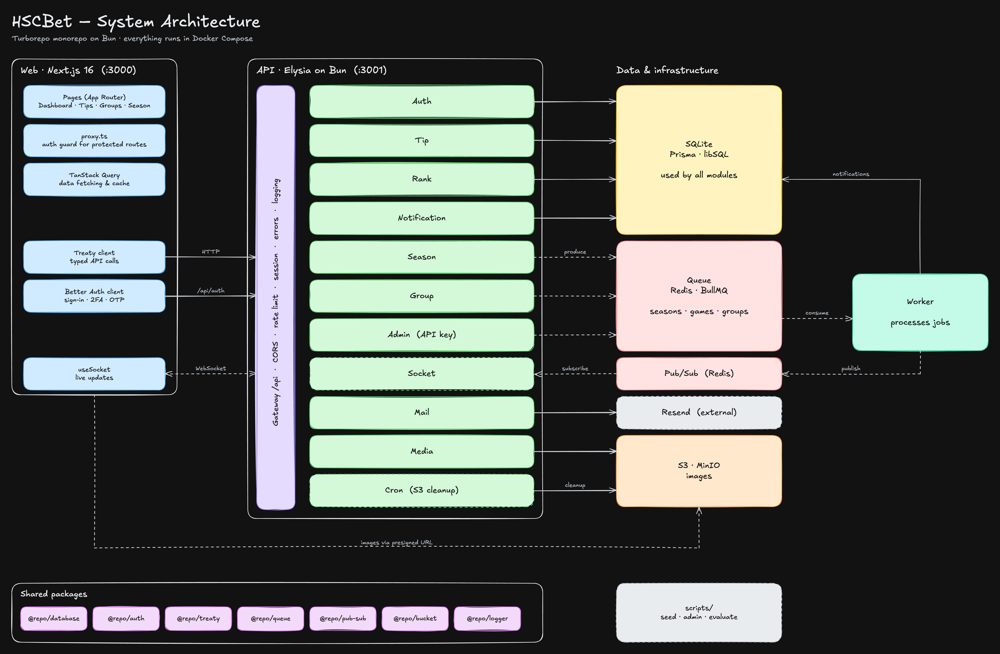

# HSCBet

The betting game for HSC 2000 Coburg. Predict match results, compete in
groups and climb the ranking.

Built as a [Turborepo](https://turborepo.dev/) monorepo on
[Bun](https://bun.sh/): Next.js frontend, Elysia API, BullMQ worker, SQLite
through Prisma, MinIO for images and Redis for the queue and pub/sub.

**[Architecture](#architecture) · [Environment](#environment-variables) ·
[Development](#development) · [Production](#production) ·
[Scripts](#scripts)**

## Architecture



The frontend calls the API through the typed Treaty client. API modules store
data in SQLite and files in S3 (MinIO). Season, group and admin actions put
jobs into the queue (Redis), which the worker processes. Results go back to the
API via pub/sub and from there to the client over a WebSocket.

| Path                | Content                                               |
| ------------------- | ----------------------------------------------------- |
| `apps/web`          | Frontend (Next.js)                                    |
| `apps/api`          | Backend (Elysia on Bun)                               |
| `packages/database` | Prisma schema, migrations and client (SQLite, libSQL) |
| `packages/auth`     | Authentication (Better Auth)                          |
| `packages/bucket`   | File storage (MinIO / S3)                             |
| `packages/queue`    | Job queue (BullMQ, Redis)                             |
| `packages/worker`   | Worker for background jobs (runs in Docker)           |
| `packages/pub-sub`  | Pub/sub over Redis                                    |
| `packages/treaty`   | Typed API client for the frontend                     |
| `packages/logger`   | Shared logger                                         |
| `scripts`           | Seed and admin scripts                                |

## Environment variables

All variables are listed in `.env.example`. Copy it to `.env` in the project
root and fill it in.

| Variable                                 | Development                         | Production                                 |
| ---------------------------------------- | ----------------------------------- | ------------------------------------------ |
| `DATABASE_URL`                           | `"file:./data/hscbet.db"`           | same, set by the compose file              |
| `API_SERVER_PORT`                        | `3001`                              | `3001`                                     |
| `WEB_SERVER_PORT`                        | `3000`                              | `3000`                                     |
| `API_SERVER_URL`                         | `http://localhost:3001`             | `https://api.hscbet.example`               |
| `WEB_SERVER_URL`                         | `http://localhost:3000`             | `https://hscbet.example`                   |
| `NEXT_PUBLIC_API_SERVER_URL`             | `http://localhost:3001`             | `https://api.hscbet.example`               |
| `NEXT_PUBLIC_WS_URL`                     | `ws://localhost:3001/api/socket`    | `wss://api.hscbet.example/api/socket`      |
| `BETTER_AUTH_SECRET`                     | random value ¹                      | new random value ¹                         |
| `BETTER_AUTH_URL`                        | `http://localhost:3001`             | `https://api.hscbet.example`               |
| `NEXT_PUBLIC_AUTH_BASE_URL`              | `http://localhost:3001`             | `https://api.hscbet.example`               |
| `MINIO_CONTAINER_NAME`                   | `hscbet-minio`                      | `hscbet-minio`                             |
| `MINIO_ROOT_USER`                        | any name, e.g. `minio`              | any name                                   |
| `MINIO_ROOT_PASSWORD`                    | at least 8 characters               | new random value ¹                         |
| `MINIO_PORT`                             | `9000`                              | `9000`                                     |
| `MINIO_CONSOLE_PORT`                     | `9001`                              | `9001`                                     |
| `MINIO_ENDPOINT`                         | `http://localhost:9000`             | `http://minio:9000`, set by compose        |
| `MINIO_PUBLIC_ENDPOINT`                  | `http://localhost:9000`             | `https://s3.hscbet.example`                |
| `MINIO_REGION`                           | `eu-central-1`                      | `eu-central-1`                             |
| `MINIO_BUCKET_NAME`                      | `hscbet-bucket`                     | `hscbet-bucket`                            |
| `MINIO_S3_PRESIGNED_URL_EXPIRATION_TIME` | `3600`                              | `3600`                                     |
| `REDIS_CONTAINER_NAME`                   | `hscbet-redis`                      | `hscbet-redis`                             |
| `REDIS_PORT`                             | `6379`                              | `6379`, set by compose                     |
| `REDIS_HOST`                             | `localhost`                         | `redis`, set by compose                    |
| `ADMIN_API_KEY`                          | random value ¹                      | new random value ¹                         |
| `SIGNUP_REVIEW_MAIL_ADDRESS`             | address that approves new sign-ups  | address that approves new sign-ups         |
| `RESEND_API_KEY`                         | can stay empty ²                    | API key from [Resend](https://resend.com/) |
| `RESEND_MAIL_ADDRESS`                    | can stay empty ²                    | sender, e.g. `noreply@hscbet.example`      |

¹ Generate with `openssl rand -base64 32`. Never reuse development values in
production.
² Without Resend no mails are sent, see [Without Resend](#without-resend).

> [!IMPORTANT]
> `NEXT_PUBLIC_*` values are baked into the frontend at build time. Restart
> `bun dev` or rebuild the images after changing them.

## Development

API and web run locally with hot reload, MinIO, Redis and the worker run in
Docker. You need [Bun](https://bun.sh/) 1.4.4 and
[Docker Desktop](https://www.docker.com/).

```sh
bun install

# 1. Create .env in the root (see the table above), then copy it everywhere.
#    Bun, Next.js and the Prisma CLI each read the .env of their own folder.
cp .env.example .env
for d in apps/api apps/web packages/*; do cp .env "$d/.env"; done

# 2. Start MinIO, Redis and the worker
bun docker:dev

# 3. Create the database and the Prisma client
bun db:migrate:dev
bun db:generate

# 4. Start API (http://localhost:3001) and web (http://localhost:3000)
bun dev
```

### First user

Sign up at http://localhost:3000/signup, approve the account (see below) and
make it an admin:

```sh
bun db:admin you@example.com            # --revoke removes the role
```

### Demo data

`bun db:seed` fills the database with seasons, matches, bets, groups and
approved demo users, e.g. `test@example.com` with password `Test123!`. It can
be run any number of times. **Never run it on a server**, the password is
public.

### Without Resend

While `RESEND_API_KEY` is empty, no mails are sent. New accounts then can't be
approved by mail: run `bun db:studio` and set `approved` to `true` for the
user in the `User` table. Password reset and email verification don't work
either.

### Changing the schema

Edit `packages/database/prisma/schema.prisma`, run `bun db:migrate:dev` and
`bun db:generate`, and commit the new migration.

## Production

`docker-compose-prod.yml` runs everything in containers: web, API, worker,
MinIO, Redis and a `migrate` service that updates the database on every
start.

**Requirements:** a Linux server with Docker Compose, Bun and `git`, ports 80 and
443 open, a reverse proxy such as [Caddy](https://caddyserver.com/) and a
[Resend](https://resend.com/) account with a verified sender domain. Point
three domains to the server:

| Domain               | Service       | Port   |
| -------------------- | ------------- | ------ |
| `hscbet.example`     | Web           | `3000` |
| `api.hscbet.example` | API and WS    | `3001` |
| `s3.hscbet.example`  | MinIO (files) | `9000` |

Web and API must run under the same parent domain, otherwise the browser
doesn't send the session cookie and login fails.

```sh
git clone <repo-url> hscbet && cd hscbet

# 1. Create .env in the root only (production column of the table above)
cp .env.example .env

# 2. Build and start
bun run docker:prod
```

The containers only listen on `127.0.0.1`, so a reverse proxy has to forward
the domains and handle HTTPS. With Caddy:

```caddyfile
hscbet.example {
	reverse_proxy localhost:3000
}

api.hscbet.example {
	reverse_proxy localhost:3001
}

s3.hscbet.example {
	reverse_proxy localhost:9000
}
```

Sign up on the site, approve the account through the mail sent to
`SIGNUP_REVIEW_MAIL_ADDRESS` and make it an admin. `bun db:admin` doesn't work
here, because the containers use their own database volume:

```sh
docker compose -f docker-compose-prod.yml exec api bun /app/scripts/admin.ts you@example.com
```

To update to a new release, run `git pull && bun run docker:prod`. Migrations
run automatically and the data is kept.

## Scripts

| Command                | Description                                       |
| ---------------------- | ------------------------------------------------- |
| `bun dev`              | Start API and web in development mode             |
| `bun run build`        | Build all apps and packages                       |
| `bun docker:dev`       | Start MinIO, Redis and the worker                 |
| `bun docker:prod`      | Build and start the production stack              |
| `bun db:migrate:dev`   | Apply migrations or create a new one              |
| `bun db:generate`      | Generate the Prisma client                        |
| `bun db:migrate:reset` | Reset the database (**deletes all data**)         |
| `bun db:seed`          | Insert demo data (local only)                     |
| `bun db:admin <email>` | Grant admin rights (`--revoke` removes them)      |
| `bun db:studio`        | Open Prisma Studio                                |
| `bun lint`             | Lint with oxlint (`bun lint:fix` to fix)          |
| `bun format`           | Format with oxfmt (`bun format:check` to check)   |
| `bun check-types`      | Check the TypeScript types                        |

## Contributing

Changes go through pull requests into `develop` and reach `main` with a
release. Branch names, commits, CI and releases are described in
[CONTRIBUTING.md](CONTRIBUTING.md), all versions in
[CHANGELOG.md](CHANGELOG.md).
